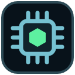
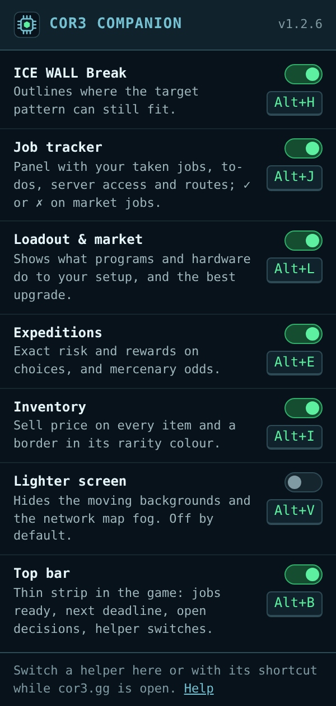
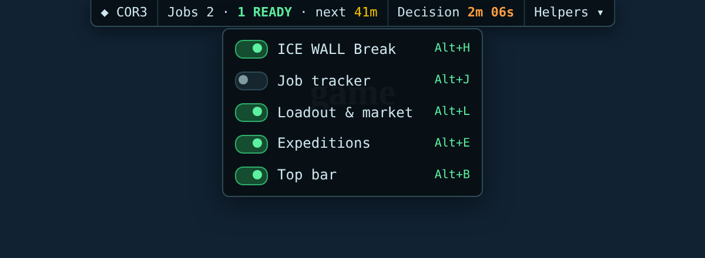

#  COR3 Companion

Browser extension for cor3.gg:

- **[ICE WALL Break](#ice-wall-break)**: highlights where the target pattern fits on the board (Alt+H toggles).
- **[Job tracker](#job-tracker)**: a panel with your taken jobs, their to-do items, server access and the route to
  each server, maintenance times and defence against your HACK power (Alt+J toggles), plus a ✓ or ✗ on the
  market's job cards that says whether you can do the job now.
- **[Expeditions](#expeditions)**: makes the risk/rewards popup on decision options clear (higher/lower, more/less
  with the exact numbers, the mission risk after the choice and the time left to decide), and shows the exact risk
  score of a mission and the death chance of each mercenary (Alt+E toggles).
- **[Loadout & market](#loadout--market)**: shows what a program or hardware part would do to your setup, on the
  loadout page and on the market's cards, and stars the best upgrade (Alt+L toggles).
- **[Inventory](#inventory)**: the sell price on every item in your inventory and a border in its
  rarity colour (Alt+I toggles).
- **[Lighter screen](#lighter-screen)**: hides the moving backgrounds and the network map fog (off by default,
  Alt+V toggles).
- **[Top bar](#top-bar)**: a thin strip at the top of the game with what needs you now and a menu to switch the
  helpers (Alt+B toggles).

Click the extension's icon in the toolbar for a list of the helpers with a switch for each, which turns the
helper on or off in your open cor3.gg tabs, the same as its shortcut.

When a newer release is out, the menu shows one small line under its header with a link to it (Chrome right away,
Firefox only if it hasn't updated itself within 2 days). It checks GitHub at most every 6 hours, only while the
menu is open.

In the game it only reads what the game already sends to your browser, and it never sends anything to the game.

## Install

Download the files from the [latest release](https://github.com/nvanderwaal/cor3-companion/releases/latest).

### Firefox

1. Click `cor3-companion-firefox.xpi` in the latest release.
2. Firefox asks to install the add-on; click **Continue to Installation**, then **Add**.

The add-on is signed by Mozilla, so it works in normal Firefox and stays installed.
It **updates itself** when a new release comes out (Firefox checks about once a day;
`about:addons` > gear icon > **Check for Updates** checks right away).

If nothing shows up on cor3.gg, click the puzzle-piece icon in the toolbar and allow the add-on on cor3.gg.

### Chrome (or Edge, Brave)

1. Download `cor3-companion-chrome.zip` and unzip it into a folder you keep, e.g. `Documents\cor3-companion`.
   Chrome loads the extension from that folder, so don't delete it.
2. Open `chrome://extensions` (Edge: `edge://extensions`) and turn on **Developer mode** (top right).
3. Click **Load unpacked** and pick that folder.

Chrome can't update extensions from outside the Chrome Web Store. For a new version, unzip the new
release's zip over the same folder and click the reload icon on the extension's card.
Chrome may show a "developer mode extensions" notice at startup; that's normal for unpacked extensions.

## ICE WALL Break

The helper tries every spot where the target pattern could fit and drops the ones that clash with a
revealed glyph or that you already guessed wrong.

- **Yellow outlines**: spots that are still possible (up to 6, the ones with the most matching
  revealed glyphs first). The text on top says how many are left, e.g. "10 possible · best 1/5 known".
- **Green outline + MATCH**: only one spot is left; that's the answer.

As more glyphs are revealed the yellow options shrink until one turns green.

## Job tracker

A panel you can drag around, minimise or hide with Alt+J. For every job you've taken it shows:

- the time left, and **READY** (green border) once the game says the job can be completed,
- a **to-do** list with the IPs, files and logs to handle, each with a checkbox you tick yourself,
- the job's servers with your access: **admin**, **access**, **no access**, **via 1 hack**, **no route** or
  **maintenance**, or **? unknown** until you've opened the network map,
- for a server you can't get into directly, the route from Home that you can walk now, e.g.
  Home → RM7-S4L2 → 10.0.0.7, with the servers you still have to hack in orange. The route skips servers in
  maintenance and servers your HACK power can't beat, and uses as few hacks as it can. With no route at all,
  hovering **no route** says which server blocks it,
- for a server in maintenance, how long it has left (**maintenance, 12m left**), and **maint. in 25m**
  when maintenance starts within 2 hours,
- for a server you don't have access to yet, its defence against your best HACK power, e.g.
  **DEF 50 · HACK 42 ✗** (red when your HACK power is lower). Open your Loadout once so it knows your HACK power.

The bottom line shows when the market was last read, when the jobs reset and how many servers are known.
The panel only updates job status while the market's Job tab has been opened, because the game only
sends those updates there.

On the market's job cards, the servers line gets one mark for the whole job: green ✓ when you can do the job
now (every server is yours, or within reach through servers your HACK power beats), red ✗ when you can't.
Hovering the ✗ lists what blocks it, e.g. a server in maintenance with its time left, a defence above your
HACK power, no route from Home, or a server that isn't on your network map yet. Open the network map and
your Loadout once so the tracker knows the routes and your HACK power.

## Expeditions

When a drone event asks for a decision, hovering an option shows the game's popup with **Risk** and
**Rewards** chevrons, which are small and coloured the wrong way round ("risk up" is green). The helper
makes that popup clear:

- After each word it writes what changes and by how much, in the right colour: Risk **HIGHER +8** (red),
  **LOWER −20** (green) or **SAME**; Rewards **MORE +3** (green), **LESS −2** (red) or **SAME**.
- A line under it sums the option up: **★ No downside**, **Trade-off: +3 loot for +8 risk**,
  **Trade-off: −20 risk for −2 loot**, **✕ More danger, nothing gained**, and so on.
- Under that, the mission's risk after the choice (**Mission risk 52 → 60**, with the new level when it
  changes) and the time left to decide.

The numbers come from the expedition data the game sends when you open Expeditions. Without it the popup
still shows the words, just without numbers. Alt+E turns the helper off and on.

The mission's risk level also shows the exact score, e.g. **MODERATE (52)**
(the game rounds 0–33 to LOW, 34–66 to MODERATE, 67–100 to HIGH).

When you set up an expedition, each mercenary the game has priced gets a line with its odds, e.g.
**Death 4% · Fail, survives 12%** (red from 10% death).
The odds appear once you've picked that mercenary in the setup, because that's when the game sends them; the
mission risk then also shows the death chance, e.g. **MODERATE (52) · death 4%**.

## Loadout & market

The helper reads your loadout when you open the Loadout page, so open it once before you shop.
It adds a short block to these cards:

- **Programs you haven't installed**: whether the program fits next to the installed ones. If it
  doesn't, whether it fits in place of an installed program with the same ability (HACK, DECRYPT, ...).
  It also shows your best power per ability before and after, and what the program would take from the
  programs that are already running. If it fits nowhere, it lists the resources you're short, e.g.
  `CPU Freq 16.2/12.7 GHz`.
- **Installed programs**: what each resource needs to reach max power, with the one holding it back
  most (the game's yellow bar) first.
- **Hardware "Change" list**: whether your setup still boots (PSU draw against PSU power) and
  how each installed program's power changes.
- **Market hardware**: the same, plus how the specs compare to the part you have now.
- **Market software**: the same as programs you haven't installed, plus a note if you already own it.

**★** marks the best upgrade among the cards on screen: per hardware category, and per ability for
software. Only parts that boot and programs that fit can get it.

The game works out program power on its server, so power for a setup you don't have yet is an
estimate (marked ≈). For programs that are installed, the helper starts from the game's real number
and only estimates the change.

## Top bar

A small strip at the top centre of the game. It only shows what needs you now, and leaves a part out when there's
nothing to say:

- **Jobs 2 · 1 READY · next 42m**: your taken jobs, how many you can hand in, and the time left on the next job that
  still needs work (red under 15 minutes). Click it to open the job tracker. With no jobs taken it shows when the
  market's jobs reset.
- **Decision 2m 10s ▾**: an expedition is waiting for your choice, with the time left (red under a minute).
  Click it to bring up the game's expedition window.
- **Expedition back**: an expedition has come back and its loot is waiting (or **Expedition back in 4m 30s** in its
  last 10 minutes). Click it to bring up the game's expedition window.
- **Helpers ▾**: the same switches as the toolbar menu, so you don't have to leave the game.

Click **◆ COR3** to shrink the bar to a single diamond, or press Alt+B to hide it. It remembers your choice.

## Inventory

When you open your inventory, every item you can sell gets its sell price in its corner, e.g. **12k cr**.
Items also get a border in their rarity colour, using the rarity the game gives each item: blue for rare,
purple for epic, orange for legendary and green for quest items. Common items keep the game's own look.
The price takes the same colour. A line above the items shows the total value of your
stash and the slots used, e.g. **Stash value 48,200 cr · 34/40 slots**. Hovering a price on a stack shows
the value of the whole stack. Alt+I turns it off and on.

## Lighter screen

Hides the game's moving background videos and the fog on the network map, and pauses them so they stop
using your computer. It is off until you switch it on with Alt+V or in the menus, and it only changes what
you see.

## Development

Building, releases and signing are described in [docs/DEVELOPMENT.md](docs/DEVELOPMENT.md).
