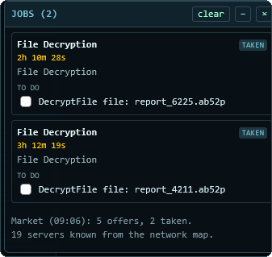

# COR3 Helper

Browser extension for cor3.gg:

- **ICE WALL Break**: highlights where the target pattern fits on the board (Alt+H toggles).
- **Job tracker**: a panel with your taken jobs, their to-do items and server access (Alt+J toggles),
  plus an access mark after the server names on the market's job cards.
- **Expeditions**: shows each decision option's risk and loot change right on the button,
  and the exact risk score of a mission.

It only reads what the game already sends to your browser; it never sends anything itself.

## Install

Download the files from the [latest release](https://github.com/nvanderwaal/cor3-helper/releases/latest).

### Firefox

1. Click `cor3-helper-firefox.xpi` in the latest release.
2. Firefox asks to install the add-on; click **Continue to Installation**, then **Add**.

The add-on is signed by Mozilla, so it works in normal Firefox and stays installed.
It **updates itself** when a new release comes out (Firefox checks about once a day;
`about:addons` > gear icon > **Check for Updates** checks right away).

If nothing shows up on cor3.gg, click the puzzle-piece icon in the toolbar and allow the add-on on cor3.gg.

### Chrome (or Edge, Brave)

1. Download `cor3-helper-chrome.zip` and unzip it into a folder you keep, e.g. `Documents\cor3-helper`.
   Chrome loads the extension from that folder, so don't delete it.
2. Open `chrome://extensions` (Edge: `edge://extensions`) and turn on **Developer mode** (top right).
3. Click **Load unpacked** and pick that folder.

Chrome can't update extensions from outside the Chrome Web Store. For a new version, unzip the new
release's zip over the same folder and click the reload icon on the extension's card.
Chrome may show a "developer mode extensions" notice at startup; that's normal for unpacked extensions.

## ICE WALL Break


The helper tries every spot where the target pattern could fit and drops the ones that clash with a
revealed glyph or that you already guessed wrong.

- **Yellow outlines**: spots that are still possible (up to 6, the ones with the most matching
  revealed glyphs first). The text on top says how many are left, e.g. "10 possible · best 1/5 known".
- **Green outline + MATCH**: only one spot is left; that's the answer.

As more glyphs are revealed the yellow options shrink until one turns green.

## Job tracker



A panel you can drag around, minimise or hide with Alt+J. For every job you've taken it shows:

- the time left, and **READY** (green border) once the game says the job can be completed,
- a **to-do** list with the IPs, files and logs to handle, each with a checkbox you tick yourself,
- the job's servers with your access: **admin**, **access**, **no access**, **unreachable** or
  **maintenance**, or **? unknown** until you've opened the network map.

The bottom line shows when the market was last read and how many servers are known.
The panel only updates job status while the market's Job tab has been opened, because the game only
sends those updates there.

On the market's job cards, each server name also gets a mark:
green ✓ access, red ✗ no access, orange ⚠ maintenance, grey ? not on your network map yet.

## Expeditions

When a drone event asks for a decision, the game only shows what each option does to risk and loot
in a hover tooltip, and colours "risk up" green. The helper puts it under every button instead:

- **Risk ▲** red, **Risk ▼** green; **Loot ▲** green, **Loot ▼** red; **–** means no change.
- **★** marks a clear win: less risk or more loot, without a downside.

The mission's risk level also shows the exact score, e.g. **MODERATE (52)**
(the game rounds 0–33 to LOW, 34–66 to MODERATE, 67–100 to HIGH).

## Development

Edit `jobs.js`, `solver.js`, `expeditions.js` or `manifest.json` in the project root.

### Build

```
node build.mjs
```

This writes `dist/`:

| Output | Use |
|---|---|
| `dist/chrome/` | Chrome: **Load unpacked** this folder to test |
| `dist/cor3-helper-chrome.zip` | Same files, zipped |
| `dist/firefox/` | Firefox: `about:debugging` > **Load Temporary Add-on** > `manifest.json` (gone after restart) |
| `dist/cor3-helper-firefox.xpi` | Unsigned Firefox package |

### Releases (GitHub Actions)

`.github/workflows/release.yml` runs on every push to `main` that changes the extension, or by hand
from the **Actions** tab (**Release** > **Run workflow**, where you can pick patch, minor or major). It:

1. bumps `version` in `manifest.json` (`node bump.mjs`),
2. builds both packages and signs the Firefox one with Mozilla (`node sign.mjs`),
3. commits the new version, tags it `vX.Y.Z` and publishes a GitHub release with
   `cor3-helper-firefox.xpi`, `cor3-helper-chrome.zip` and `updates.json`.

Changes to only the README, `docs/` or the workflow don't start a release. A run takes 3–5 minutes,
most of it "Waiting for approval..." while Mozilla signs; don't cancel it, a signed version can't be
signed again. Pull after a release, since the workflow pushes the version commit to `main`.

It needs two repository secrets (Settings > Secrets and variables > Actions):
`WEB_EXT_API_KEY` (JWT issuer) and `WEB_EXT_API_SECRET` (JWT secret), from
https://addons.mozilla.org/developers/addon/api/key/

### Signing locally

1. Copy `.env.example` to `.env` and fill in the same two keys (`.env` is git-ignored).
2. Bump `version` in `manifest.json`, then run `node sign.mjs`.
   The signed `.xpi` lands in `web-ext-artifacts/`.

Use the GitHub release instead where you can: a version signed locally can't be released by the workflow.
