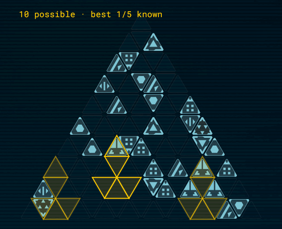
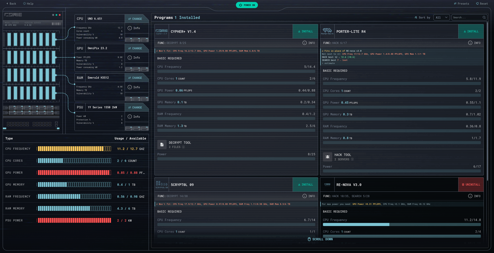
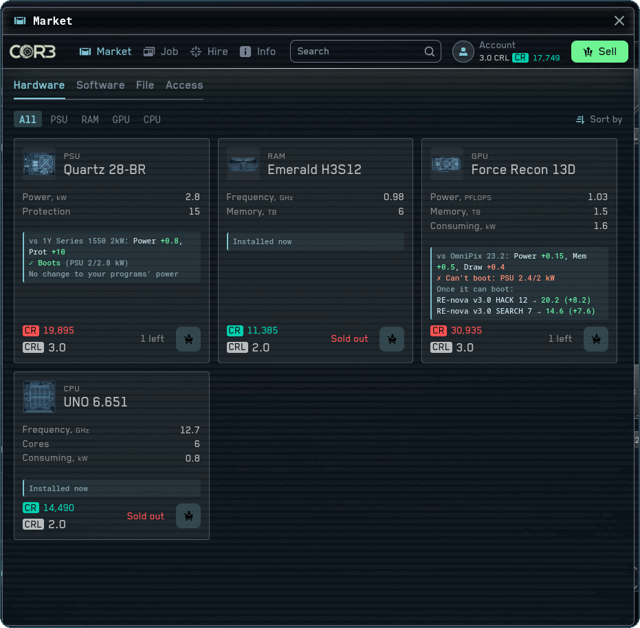

#  COR3 Companion

Browser extension for cor3.gg:

- **[ICE WALL Break](#ice-wall-break)**: highlights where the target pattern fits on the board (Alt+H toggles).
- **[Job tracker](#job-tracker)**: a panel with your taken jobs, their to-do items and server access (Alt+J toggles),
  plus an access mark after the server names on the market's job cards.
- **[Expeditions](#expeditions)**: makes the risk/rewards popup on decision options clear (higher/lower, more/less
  and a one-line verdict), and shows the exact risk score of a mission.
- **[Loadout & market](#loadout--market)**: shows what a program or hardware part would do to your setup, on the
  loadout page and on the market's cards, and stars the best upgrade (Alt+L toggles).

Click the extension's icon in the toolbar for a list of the helpers and their shortcuts.

It only reads what the game already sends to your browser; it never sends anything itself.

## Install

Download the files from the [latest release](https://github.com/nvanderwaal/cor3-helper/releases/latest).

### Firefox

1. Click `cor3-companion-firefox.xpi` in the latest release.
2. Firefox asks to install the add-on; click **Continue to Installation**, then **Add**.

The add-on is signed by Mozilla, so it works in normal Firefox and stays installed.
It **updates itself** when a new release comes out (Firefox checks about once a day;
`about:addons` > gear icon > **Check for Updates** checks right away).

If nothing shows up on cor3.gg, click the puzzle-piece icon in the toolbar and allow the add-on on cor3.gg.

### Chrome (or Edge, Brave)

1. Download `cor3-companion-chrome.zip` and unzip it into a folder you keep, e.g. `Documents\cor3-companion`.
   Chrome loads the extension from that folder, so don't delete it.
2. Open `chrome://extensions` (Edge: `edge://extensions`) and turn on **Developer mode** (top right).
3. Click **Load unpacked** and pick that folder.

Chrome can't update extensions from outside the Chrome Web Store. For a new version, unzip the new
release's zip over the same folder and click the reload icon on the extension's card.
Chrome may show a "developer mode extensions" notice at startup; that's normal for unpacked extensions.

## ICE WALL Break

The helper tries every spot where the target pattern could fit and drops the ones that clash with a
revealed glyph or that you already guessed wrong.

- **Yellow outlines**: spots that are still possible (up to 6, the ones with the most matching
  revealed glyphs first). The text on top says how many are left, e.g. "10 possible · best 1/5 known".
- **Green outline + MATCH**: only one spot is left; that's the answer.

As more glyphs are revealed the yellow options shrink until one turns green.

## Job tracker

A panel you can drag around, minimise or hide with Alt+J. For every job you've taken it shows:

- the time left, and **READY** (green border) once the game says the job can be completed,
- a **to-do** list with the IPs, files and logs to handle, each with a checkbox you tick yourself,
- the job's servers with your access: **admin**, **access**, **no access**, **unreachable** or
  **maintenance**, or **? unknown** until you've opened the network map.

The bottom line shows when the market was last read and how many servers are known.
The panel only updates job status while the market's Job tab has been opened, because the game only
sends those updates there.

On the market's job cards, each server name also gets a mark:
green ✓ access, red ✗ no access, orange ⚠ maintenance, grey ? not on your network map yet.

## Expeditions

When a drone event asks for a decision, hovering an option shows the game's popup with **Risk** and
**Rewards** chevrons, which are small and coloured the wrong way round ("risk up" is green). The helper
makes that popup clear:

- After each word it writes what changes, in the right colour: Risk **HIGHER** (red), **LOWER** (green)
  or **SAME**; Rewards **MORE** (green), **LESS** (red) or **SAME**.
- A line under it sums the option up: **★ No downside**, **Trade-off: more loot, more danger**,
  **Trade-off: safer, less loot**, **✕ More danger, nothing gained**, and so on.

The mission's risk level also shows the exact score, e.g. **MODERATE (52)**
(the game rounds 0–33 to LOW, 34–66 to MODERATE, 67–100 to HIGH).

## Loadout & market

The helper reads your loadout when you open the Loadout page, so open it once before you shop.
It adds a short block to these cards:

- **Programs you haven't installed**: whether the program fits next to the installed ones. If it
  doesn't, whether it fits in place of an installed program with the same ability (HACK, DECRYPT, ...).
  It also shows your best power per ability before and after, and what the program would take from the
  programs that are already running. If it fits nowhere, it lists the resources you're short, e.g.
  `CPU Freq 16.2/12.7 GHz`.
- **Installed programs**: what each resource needs to reach max power, with the one holding it back
  most (the game's yellow bar) first.
- **Hardware "Change" list**: whether your setup still boots (PSU draw against PSU power) and
  how each installed program's power changes.
- **Market hardware**: the same, plus how the specs compare to the part you have now.
- **Market software**: the same as programs you haven't installed, plus a note if you already own it.

**★** marks the best upgrade among the cards on screen: per hardware category, and per ability for
software. Only parts that boot and programs that fit can get it.

The game works out program power on its server, so power for a setup you don't have yet is an
estimate (marked ≈). For programs that are installed, the helper starts from the game's real number
and only estimates the change.

## Development

Building, releases and signing are described in [docs/DEVELOPMENT.md](docs/DEVELOPMENT.md).
